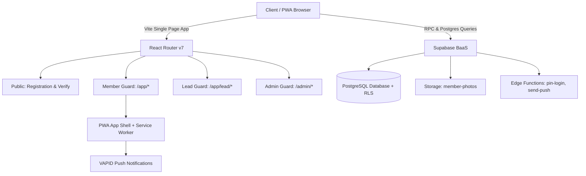

<div align="center">

<!-- HERO BANNER PLACEHOLDER -->


<br/><br/>

# ⚡ SAMBHAV 4.0 — Unified Portal & Progressive Web App
### *The Next-Generation Digital Headquarters for Fest Volunteers, Domain Leads & Administrators*

<p align="center">
  <a href="#-overview">Overview</a> •
  <a href="#-features-at-a-glance">Features</a> •
  <a href="#-architecture--tech-stack">Tech Stack</a> •
  <a href="#-screenshots--ui-showcase">UI Showcase</a> •
  <a href="#-installation--setup">Getting Started</a> •
  <a href="#-routes--roles">User Roles & Routes</a> •
  <a href="#-security--rls">Security</a> •
  <a href="#-deployment">Deployment</a>
</p>

<!-- BADGES -->
[](https://react.dev/)
[](https://www.typescriptlang.org/)
[](https://vitejs.dev/)
[](https://supabase.com/)
[](https://web.dev/progressive-web-apps/)
[](#)

</div>

---

## 🌟 Overview

**Sambhav 4.0** is an end-to-end, mobile-first festival management ecosystem designed to streamline volunteer onboarding, identity verification, domain collaboration, and real-time announcements.

Built around a bold **neo-brutalist aesthetic** (`#14123A` ink, `#2B34F0` blue, `#FFB81C` sun, `#35CDB2` mint, `#FF6FA8` pink), the platform combines:
1. **Public Registration Portal**: Fast, delightful 3-minute volunteer registration with live image cropping, roster validation, and automated digital team pass generation.
2. **Offline-Capable Members PWA**: An installable progressive web app featuring Web Push notifications, offline cache, digital membership card with dynamic QR verification, announcements, and event check-in systems.
3. **Domain Lead Suite**: Dedicated control center for team leads to coordinate meetings, track attendance via camera scanners, and notify domain squads.
4. **Command Center (Super Admin)**: Real-time registration metrics, whitelist filtering, edit request auditing, full-screen badge scanning, and global push broadcasts.

---

## 🚀 Features at a Glance

```
┌─────────────────────────────────────────────────────────────────────────────────┐
│                           SAMBHAV 4.0 ECOSYSTEM                                 │
├───────────────────────┬─────────────────────────┬───────────────────────────────┤
│  PUBLIC ONBOARDING    │      MEMBERS PWA        │      ADMIN / LEAD SUITE       │
├───────────────────────┼─────────────────────────┼───────────────────────────────┤
│ • Interactive Roster  │ • Installable PWA       │ • Real-time Metrics Overview  │
│ • Domain Pickers      │ • Web Push (VAPID)      │ • Whitelist Roster Audits     │
│ • HEIC Photo Cropper  │ • Roll + PIN / Google   │ • Edit Requests Moderation    │
│ • Digital Team Pass   │ • Live Digital ID Card  │ • Fullscreen Camera Scanner   │
│ • Edit Request Window │ • Offline Cached Data   │ • Push Announcement Broadcast │
│ • Public QR Verify    │ • Event RSVPs & Checkin │ • Role & PIN Delegation       │
└───────────────────────┴─────────────────────────┴───────────────────────────────┘
```

### 📱 Public Registration & Pass
- **Zero-Friction Registration**: Select recruited domain (Management, Tech, Media, PR, etc.) and complete registration in under 3 minutes.
- **Roster & Regex Enforcement**: Auto-validates applicant credentials against institutional roll number regex and the pre-approved festival roster.
- **Smart Image Upload**: Native support for camera capture, gallery selection, client-side HEIC-to-JPEG conversion, and square cropping.
- **Digital Team Pass**: High-resolution digital pass equipped with domain glyphs, custom color themes, and quick-save options.

### 📲 Progressive Web App (PWA)
- **Install to Home Screen**: Installable as a native-feeling app on iOS, Android, and Desktop with offline fallback caching via Service Workers.
- **Flexible Auth**: Support for **Google OAuth** (matching verified email) and **Institutional Roll + One-Time PIN** login with compulsory self-service PIN setup.
- **Interactive ID Card**: Visual digital identification displaying member number, roll, domain, and an 18-hex security token QR code.
- **Public Scanner Verification**: `/verify/:publicId` validates cards instantaneously with no login required, protecting member privacy while preventing forgery.
- **Push Notifications**: Cloud-backed push notifications powered by VAPID keys and Supabase Edge Functions.

### 🛡️ Admin & Lead Operations
- **Domain Lead Dashboard**: Filtered tools allowing domain leads to view approved domain members, publish domain-specific notices, and manage attendance.
- **Rapid Attendance Check-In**: Camera-based QR code scanner with haptic feedback and fallback 4-digit OTP codes (with 8-attempt brute-force protection).
- **Edit Requests Pipeline**: Two-way workflow where members request profile corrections and administrators review diffs with 1-click approvals.
- **Orphan Photo Cleaner**: Automatic maintenance scanner identifying unlinked storage objects to save bandwidth and storage quotas.

---

## 📸 Screenshots & UI Showcase

<div align="center">

| Public Domain Selector | Registration Pass |
|:---:|:---:|
|  |  |

| Members Mobile PWA | Admin Management Suite |
|:---:|:---:|
|  |  |

</div>

---

## 🛠️ Architecture & Tech Stack



| Layer | Technologies |
|---|---|
| **Frontend Core** | React 19, TypeScript 5, Vite 8, React Router |
| **Offline & PWA** | `vite-plugin-pwa`, Workbox Precaching & Routing |
| **Styling & Motion** | Scoped Neo-Brutalist CSS, GSAP 3, Anime.js, Lucide Icons |
| **Backend & Database** | Supabase Postgres with strict Row-Level Security (RLS) |
| **Authentication** | Supabase Auth (Google OAuth) + Edge Function PIN Validation |
| **Hardware & Utilities** | Web Camera Scanning (`qr-scanner`), QR Generator (`qrcode`), `heic2any` |
| **Hosting & CDN** | Vercel Serverless CDN with PWA cache headers |

---

## 🗂️ Project Directory Structure

```plaintext
sambhav-registration/
├── public/                     # Static assets, favicons, PWA manifest icons
│   ├── icons/                  # 192x192, 512x512 maskable & monochrome icons
│   └── favicon.svg             # Neo-brutalist dual-ring favicon
├── src/
│   ├── components/             # Reusable core widgets & shells
│   │   ├── admin/              # Admin-specific widgets (Flags, Access Drawer)
│   │   ├── forms/              # Announcement and Event modal forms
│   │   ├── member/             # PWA design system (Buttons, Chips, Toasts)
│   │   ├── AppShell.tsx        # Bottom tab navigation & header shell
│   │   ├── IdScanner.tsx       # Real-time camera QR scanner
│   │   └── MemberLoginLink.tsx # Public CTA link to Members PWA
│   ├── contexts/               # AppContext, AdminContext, MemberContext
│   ├── hooks/                  # usePush, useInstall, useQr, useLoad
│   ├── lib/                    # Supabase client, CSV, ICS, Cache, Dates
│   ├── pages/
│   │   ├── admin/              # Overview, Members, Events, Audit, Settings
│   │   ├── lead/               # Domain Lead dashboard, events & rosters
│   │   ├── member/             # Home, Announcements, Events, ID Card, Profile
│   │   ├── public/             # VerifyMember (/verify/:publicId)
│   │   ├── Home.tsx            # Festival landing page & domain picker
│   │   ├── Register.tsx        # Volunteer registration form & cropper
│   │   └── Success.tsx         # Digital team pass confirmation
│   ├── styles/                 # global index.css, member.css, admin.css
│   ├── sw.ts                   # Custom Service Worker (Push + Precaching)
│   ├── routes.tsx              # Code-split route matrix with security guards
│   └── App.tsx                 # Root application wrapper & providers
├── supabase/
│   └── functions/              # Deno Edge Functions (pin-login, send-push)
├── vercel.json                 # PWA headers & edge rewrites
└── vite.config.ts              # Vite + VitePWA injectManifest configuration
```

---

## 🚦 Routes & Roles

| URL Path | Access Level | Description |
|---|---|---|
| `/` | Public | Landing page with festival overview & domain links |
| `/register/:domainSlug` | Public | 3-step registration form for recruited volunteers |
| `/success` | Public | Live team pass confirmation with shareable link |
| `/verify/:publicId` | Public | Volunteer badge validation (tamper-proof) |
| `/app/login` | Public | Member sign-in (Google OAuth or Roll + PIN) |
| `/app` | Member | Members home feed with announcements & upcoming events |
| `/app/id` | Member | High-resolution interactive Member ID card |
| `/app/events` | Member | Schedule, agenda, venue info & attendance PIN check-in |
| `/app/lead` | Domain Lead | Domain squad management, check-in scanner & notices |
| `/admin` | Administrator | Global metrics, whitelists, role delegations & settings |
| `/admin/scan` | Staff / Admin | High-speed full-screen attendee barcode scanner |

---

## ⚙️ Installation & Setup

### 1. Prerequisites
- **Node.js** v20.x or higher
- **npm** or **pnpm**
- A **Supabase** project instance with migrations applied

### 2. Clone and Install
```bash
# Clone the repository
git clone https://github.com/dependant-coder/SAMBHAV-Registrations.git

# Enter project directory
cd SAMBHAV-Registrations

# Install all dependencies
npm install
```

### 3. Environment Variables
Copy `.env.example` to `.env.local`:
```bash
cp .env.example .env.local
```

Fill in your configuration keys:
```env
# Supabase Configuration
VITE_SUPABASE_URL=https://your-project-id.supabase.co
VITE_SUPABASE_ANON_KEY=your-anon-key

# Production Domain (Used for QR links & canonical headers)
VITE_SITE_URL=https://your-fest-domain.vercel.app

# Push Notifications (Web Push VAPID Public Key)
VITE_VAPID_PUBLIC_KEY=your-vapid-public-key

# Support WhatsApp link
VITE_HELP_WHATSAPP=https://wa.me/919999999999
```

### 4. Running Locally
```bash
# Start local development server
npm run dev
```
Visit `http://localhost:3000` in your browser.

---

## 🧪 Verification & Production Build

To verify TypeScript compliance, compile the Service Worker, and build production assets:

```bash
# Type check application
npx tsc --noEmit -p .

# Type check Service Worker
npx tsc --noEmit -p tsconfig.sw.json

# Build client bundle & PWA service worker
npm run build

# Preview production build locally
npm run preview
```

---

## 🔐 Security & Architecture Highlights

> [!IMPORTANT]
> The database strictly enforces **Row-Level Security (RLS)**. No student or public visitor can query unapproved rosters, member emails, or phone numbers.

- **Zero Client-Side Secret Leakage**: The service-role key and VAPID private keys are **never** bundled into the client code.
- **Privacy-Preserving Verification**: Public QR scans at `/verify/:publicId` invoke a security-definer function returning only public identity fields (Name, Domain, Role, Member #), concealing sensitive emails and phone numbers.
- **Brute-Force Shield**: Event check-in PIN entries automatically freeze an attendee after 8 incorrect attempts to prevent automated code enumeration.
- **Scoped Styles**: All member PWA interfaces are scoped inside `.mapp-root` to prevent visual collision with existing festival landing page designs.

---

## 🌐 Production Deployment (Vercel)

1. Push your changes to GitHub:
   ```bash
   git push origin main
   ```
2. Import the project in [Vercel](https://vercel.com).
3. Ensure the environment variables from `.env.local` are added to **Vercel Project Settings**.
4. Confirm `vercel.json` provides correct no-cache headers for `/sw.js` and `/manifest.webmanifest`.
5. Deploy!

---

<div align="center">

Made with ❤️ for **Sambhav 4.0** by the Tech & Core Management Teams.

<sub>Crafted with React, TypeScript, Vite & Supabase.</sub>

</div>
